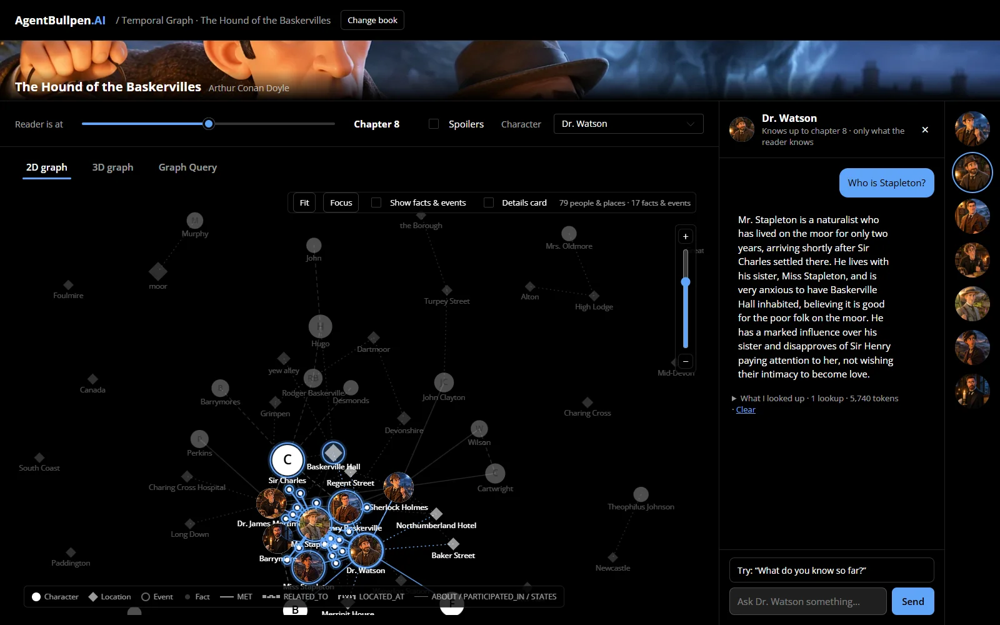

# AgentBullpen Temporal Graph

Read a novel with a spoiler-safe map of it. An LLM pipeline indexes each book into a temporal knowledge graph — characters, places, facts and events, each stamped with where in the text the reader learns it — and the web app lets you move a timeline through the chapters, explore the graph in 2D and 3D, query it in openCypher, and **chat with the characters**, who know only what the reader has been shown by that chapter.



Three books come indexed (`data/books/`): *The Hound of the Baskervilles*, *The Three Musketeers* and *Treasure Island*, from their Project Gutenberg texts. Any other Gutenberg book can be added with one command.

**Docs:** [docs/README.md](docs/README.md), also served by the app at `/docs` — a [guide](docs/guide/) to running and extending it, the [design](docs/design/) (how it works and why) and the [story](docs/story/).

## Quickstart

1. **Prerequisites:** .NET SDK 10 (`global.json`), Node.js 22 or later, Aspire CLI 13.6.0.

2. **Set up a model** — only the chat needs one; everything else runs without it.
   ```
   ./temporalgraph.cli.sh setup
   ```
   On Windows, `.\temporalgraph.cli.ps1 setup`. It asks for a provider (OpenAI, Anthropic, Azure OpenAI or OpenRouter), a model and your API key at a hidden prompt, can test the key with one short call, and saves to the user-secrets store the API and the CLI share. `setup status` shows what is configured; `setup reset` removes what setup wrote. A coding agent follows [AGENTS.md](AGENTS.md) and never sees the key.

   <details>
   <summary>Manual setup with <code>dotnet user-secrets</code></summary>

   Run one block from the repo folder.

   OpenAI:
   ```
   dotnet user-secrets set --project src/TemporalGraph.Api "Llm:Profiles:openai:Type" OpenAI
   dotnet user-secrets set --project src/TemporalGraph.Api "Llm:Profiles:openai:Model" gpt-4o-mini
   dotnet user-secrets set --project src/TemporalGraph.Api "Llm:Profiles:openai:ApiKey" <your-openai-key>
   dotnet user-secrets set --project src/TemporalGraph.Api "Chat:Llm" openai
   ```
   Anthropic:
   ```
   dotnet user-secrets set --project src/TemporalGraph.Api "Llm:Profiles:anthropic:Type" Anthropic
   dotnet user-secrets set --project src/TemporalGraph.Api "Llm:Profiles:anthropic:Model" claude-haiku-5-5
   dotnet user-secrets set --project src/TemporalGraph.Api "Llm:Profiles:anthropic:MaxOutputTokens" 16000
   dotnet user-secrets set --project src/TemporalGraph.Api "Llm:Profiles:anthropic:ApiKey" <your-anthropic-key>
   dotnet user-secrets set --project src/TemporalGraph.Api "Chat:Llm" anthropic
   ```
   Azure OpenAI (the model is your deployment's name):
   ```
   dotnet user-secrets set --project src/TemporalGraph.Api "Llm:Profiles:azure:Type" OpenAI
   dotnet user-secrets set --project src/TemporalGraph.Api "Llm:Profiles:azure:Endpoint" https://<resource>.openai.azure.com/openai/v1/
   dotnet user-secrets set --project src/TemporalGraph.Api "Llm:Profiles:azure:Model" <deployment-name>
   dotnet user-secrets set --project src/TemporalGraph.Api "Llm:Profiles:azure:ApiKey" <your-azure-key>
   dotnet user-secrets set --project src/TemporalGraph.Api "Chat:Llm" azure
   ```
   OpenRouter:
   ```
   dotnet user-secrets set --project src/TemporalGraph.Api "Llm:Profiles:openrouter:Type" OpenAI
   dotnet user-secrets set --project src/TemporalGraph.Api "Llm:Profiles:openrouter:Endpoint" https://openrouter.ai/api/v1
   dotnet user-secrets set --project src/TemporalGraph.Api "Llm:Profiles:openrouter:Model" openai/gpt-4o-mini
   dotnet user-secrets set --project src/TemporalGraph.Api "Llm:Profiles:openrouter:ApiKey" <your-openrouter-key>
   dotnet user-secrets set --project src/TemporalGraph.Api "Chat:Llm" openrouter
   ```

   </details>

3. **Run it:** `aspire run`, then open the URL the dashboard shows for the **web** resource. If the browser doesn't trust the dashboard's certificate, run `dotnet dev-certs https --trust` once.

## Add any Gutenberg book

```
./temporalgraph.cli.sh books add <ref>
./temporalgraph.cli.sh index run --book <id> --promote
./temporalgraph.cli.sh chat --book <id>
```

`<ref>` is a Gutenberg number (`2852`), a gutenberg.org URL, a `.txt` URL or a local `.txt` file. Indexing needs a model (`setup add … --indexing`) and, once, BookNLP ([Cross-check tools](docs/guide/tools.md)); `--dry-run` shows the token estimate and runs nothing, `--budget-tokens <n>` caps a run. Rebuild the API to see the new book in the web app. Commands, flags, run folders and promotion: [Indexing a book](docs/guide/indexing.md). With no arguments, `./temporalgraph.cli.sh` opens a menu of the same things.

To rebuild every book: `./temporalgraph.rebuild.sh --dry-run`, then `./temporalgraph.rebuild.sh --budget-tokens <N>`.

## Build and test

```
dotnet build
dotnet test
cd web && npm ci && npm test && npm run build
```

## More

- **Let readers pick a model:** list extra profiles in `Chat:Models` (or `setup add <profile> … --pickable`); the chat panel shows a picker. [Configuration](docs/guide/configuration.md).
- **Vet a model before you authorise it:** `./temporalgraph.cli.sh chat vet --llm <profile>` checks the spoiler gate, tool use and voice, and exits 4 on a failure.
- **Run behind a gateway:** the same build runs behind the [AgentBullpen.AI](https://agentbullpen.ai) site's gateway once `Auth:Gateway:SigningKey` and `VITE_API_BASE_URL` are set; standalone is the default. [Models and gateway](docs/design/models.md).
- **Deploying:** the API is an ordinary ASP.NET Core container (`dotnet publish -t:PublishContainer`) and the web app a static Vite build (`web/dist`); host them however you like. No deployment pipeline ships with the repo.

## Contributing

This is a sample to clone or fork; it isn't accepting pull requests or issues.

## Licence

[MIT](LICENSE). The book texts and images: see [NOTICE](NOTICE.md).
