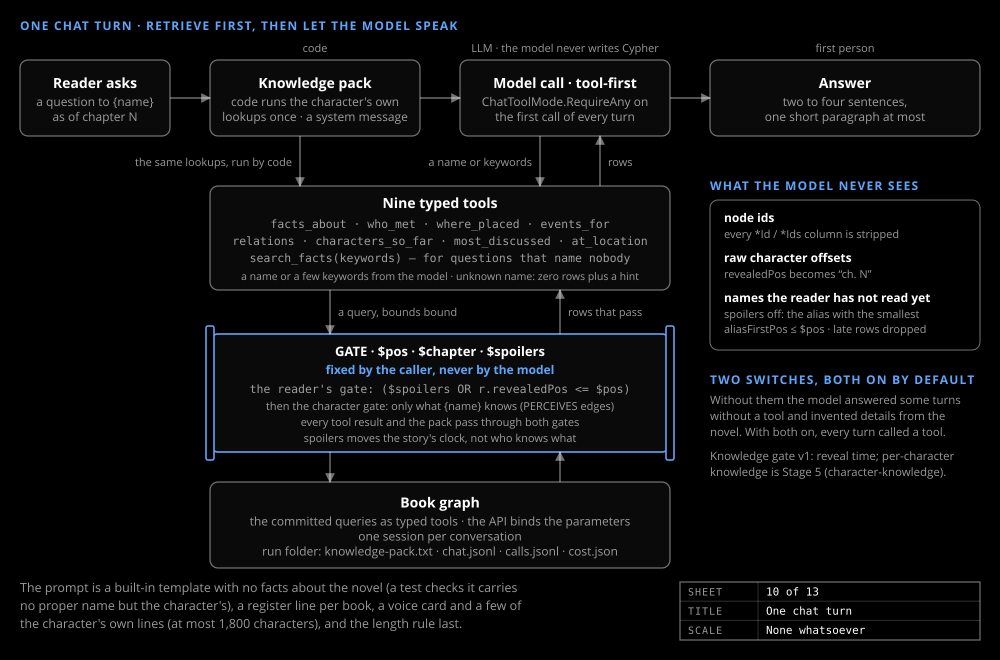

# Character chat

_Design & research_

The character's voice is authored; its knowledge comes only from the graph as of the selected moment. The committed queries run as typed tools with `$pos`, `$chapter` and `$spoilers` fixed by the caller; the model supplies a name or a few keywords and never writes Cypher.

## Tools

One agent serves the CLI (`chat`), the API's `chat` mutation and the browser panel. Nine tools: `facts_about`, `who_met`, `where_placed`, `events_for`, `relations`, `characters_so_far`, `most_discussed`, `at_location`, and `search_facts(keywords)` for questions that name nobody ("Who is the killer?").

## Two switches

Both on by default. The knowledge pack: code runs the character's own lookups once and sends them as a system message, "What you, {name}, know at this point (from the record; nothing else is known)". Tool-first: `ChatToolMode.RequireAny` on the first call of every turn. Without them the model answered 7 of 20 audited turns with no tool, "and that is where it invented hound lore from the novel".

## The data boundary

The model never sees node ids, raw offsets (`revealedPos` becomes `ch. N`), or, with spoilers off, any name the reader has not read yet. A row about an entity not yet mentioned is dropped before the model sees it, with the count shown: the leak is closed in code.

## The character gate

Holmes, in London during chapter 7, must not tell chapter 7. `CharacterGate` works that out from the `PERCEIVES` edges ([The graph model](graph-model.md)), and every tool result and the pack pass through it after the reader's gate: only facts the character knows, events it took part in or that discovered those facts, people it perceives or shares an event with, and names it has met. Every other name is a never-say word for that conversation. Spoilers moves the story clock, not who knows what; `Chat:CharacterGate: false` turns the gate off, to compare.

## Names and voices

A character is shown by its `books.json` roster spelling once the text has used it, else by its short name, else by the earliest alias the reader has met; one rule names the roster, prompt, tool rows and graph labels. The prompt template carries no fact about the novel: a per-book register line, a length rule, and a voice layer from `data/books/<id>/voice/`, a plot-free guide and card per character plus up to `Chat:VoiceExamples` of the character's own lines, mined by `index voice` and, with spoilers off, only from the reader's chapter or earlier.
