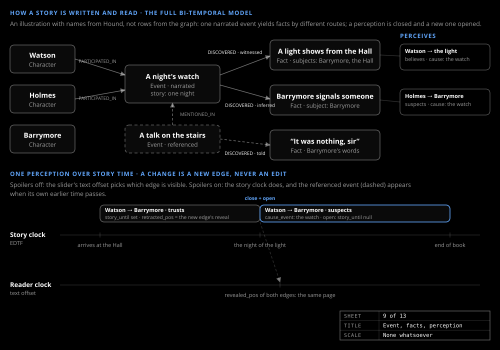

# The graph model

_Design & research_

A story is written as events, read as facts, and held by characters as perceptions. Events and facts are nodes, perceptions are edges, and a changed perception is a new edge, never an edit.

## Nodes

| Label | What it is |
|---|---|
| `Character` | `name`, `aliases`, a short name |
| `Location` | A place |
| `Event` | A scene: `narrated` or `referenced` (told inside another scene). `summary`, at least one participant |
| `Fact` | One declarative sentence about the world of the book, its subjects, the evidence quote. A belief is a perception edge, never a fact's truth value |

Facts are nodes so that several events can discover one fact and several characters can perceive it differently. Every node and edge carries both clocks ([Two clocks](two-clocks.md)).

## Edges

`PARTICIPATED_IN` (Character → Event) carries a `role`. `DISCOVERED` (Event → Fact) carries `how`: `witnessed`, `told`, `overheard`, `inferred`, `read` or `recalled`. `PERCEIVES` (Character → Fact or Character) carries one `kind` and its `cause_event`. `MENTIONED_IN` joins a referenced event to the narrated event that tells it. `IDENTICAL_TO` joins two `Character` nodes that are one person under two names; never a merge. `LOCATED_AT` and `RELATED_TO` complete the set.

## Discovery seeds perception

`kind` is one of twelve named values: `believes`, `doubts`, `disbelieves`; `trusts`, `distrusts`, `suspects`; `threatened`, `reassured`; `fearful`, `hopeful`, `curious`, `indifferent`.

Stage 5 seeds perception by code from the route: `witnessed`, `read` or `recalled` seeds `believes`; `told` or `overheard` seeds `believes` unless the listener holds an open `distrusts` or `suspects` toward the speaker, then `doubts`. The model is spent only on perceptions the text states with a quote and on changes. What a character knows is the set of facts it has a perception edge to, excluding `disbelieves`.

## A perception closes and reopens

When a later event changes a perception, the open edge is closed (`story_until` and `retracted_pos` set from the new edge) and a new edge opens with its own `cause_event`. The history stays: Watson trusts Barrymore until he sees the candle at the window and suspects him from then; both edges stay, and the slider shows whichever is open. A perception changes in story time, not on the page where the reader is told, so perceptions give the story clock its content while the reveal clock hides the change from a reader who has not reached it.

Storage is one SQLite file per book ([Database schema](../guide/schema.md)).
