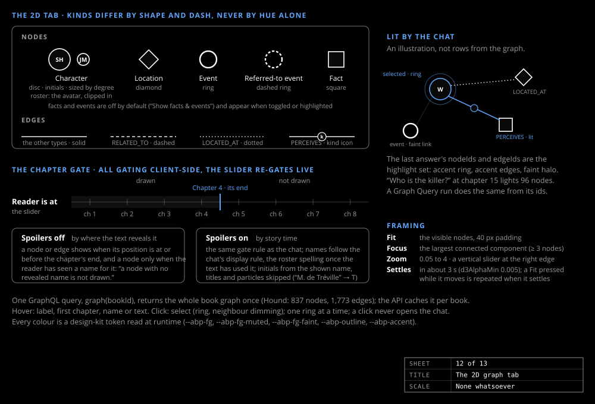

# The graph view

_Design & research_

What lights up is what was retrieved, from the chat or from a query: the view is the proof that the character answers from the graph.

## One payload, gated in the browser

One GraphQL query, `graph(bookId)`, returns the whole book graph once, with every element's reveal position, every alias's first mention and every node's position. All gating is client-side, so the slider re-gates live and nothing moves.

## The layout is data

The browser runs no force simulation. The layout is computed once per graph, at index time: `index layout` (and `build-db`) runs `web/scripts/layout.mjs`, a d3-force-3d simulation with the forces the tabs used to apply, over the whole ungated graph, with a fixed seed and 300 ticks, and stores each node's 3D and 2D position in the book database. The tabs pin every node where it is stored; gating only hides and shows. A book database without a layout is laid out once in a Web Worker, with the same code, while the pane says "Laying out…".

The simulation used to run on the main thread on every load and every re-gating; on the largest book with facts on, that held the page at about 10 frames a second and a click took over a second to register.

The `gate` is the chat's rule: with spoilers off an element shows when its position is at or before the chapter's end, and a node only when the reader has seen a name for it. Facts and events are off by default and appear when toggled or highlighted.

## Shapes, not hues

| Kind | 2D | 3D |
|---|---|---|
| Character | disc with initials, sized by degree | sphere |
| Location | diamond | octahedron |
| Event | ring, dashed when referenced | torus |
| Fact | square | cube |
| `PERCEIVES` | its kind's icon at the midpoint | its kind's icon at the midpoint |
| `RELATED_TO` / `LOCATED_AT` | dashed / dotted | — |

Every colour is a design-kit token, so the view is grayscale-safe by construction: kinds differ by shape and dash, never by hue alone. A click selects; only the roster row and the selection card's Chat button open the chat.

## Lit by the chat and the query tab

Each tool call in a chat answer returns the `nodeIds` and `edgeIds` of the rows the model saw ([Character chat](chat.md)); the browser keeps the last answer's ids as the highlight set. A Graph Query run does the same from its result's id columns.

## Framing

Fit zooms to the visible nodes; Focus zooms to the largest connected component, automatically after the first layout and after a re-gating that changes the visible set by more than a fifth. In 3D a character chosen from the dropdown or the roster gets a camera flight framing it with its best-connected neighbours; a node click never moves the camera.

## 2D and 3D

The 3D tab is `react-force-graph-3d` behind `React.lazy`, sharing the gate, selection, Fit and Focus code. It gives its WebGL context back when left, because a browser keeps only about sixteen per process. Shared geometries and materials, and the unlit fact and event links drawn as one line set, took the largest book from 16 to 38 fps settled. Facts and events are instanced meshes (one per shape and look) and the perception icons are point sets, so that book with facts on is about 580 draw calls and holds 60 fps while rotating. The 2D tab redraws only when something changes, strokes the plain links and small nodes as a few paths, and stamps each perception icon from a cached image.
