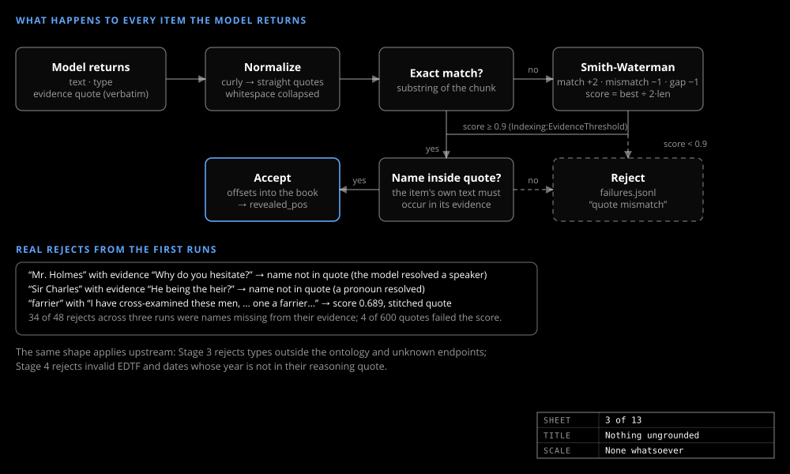

# Entities and grounding

_Design & research_

Every node, edge and story date carries an evidence quote that code verifies.

## The evidence check

Code looks for each item's quote in the book: normalize quotes and whitespace, try an exact match, otherwise align it with Smith-Waterman and score it. Below `Indexing:EvidenceThreshold` (0.9), or if the item's own name is not inside its quote, the item is rejected to `failures.jsonl` as `quote mismatch`; never silently kept. The accepted quote's offsets become the item's position: the reader clock.

The rejects caught the model doing coreference: "Mr. Holmes" came back with the evidence *"Why do you hesitate?"*, a line Holmes speaks that does not name him. Strong models mis-copy quotes about 5% of the time, hence the fuzzy match.

Stage 3 rejects any edge type outside the ontology and any endpoint that is not a known entity of the right type. Stage 4 requires a quote for every story date, with the year in it unless marked approximate. A claim is not a fact: what a character says is `DISCOVERED` with `how` = `told` to the listeners plus the speaker's own `PERCEIVES` edge, never world truth. The price is recall: a good fact with a sloppy quote is lost, on purpose.

## Entities: BookNLP as backbone

Stage 1 asks for every named or clearly identifying mention of a person or place, typed `Character` or `Location`, no pronouns. A model alone keeps mistyping a society or a journal as an entity; BookNLP's tags solve that. So BookNLP runs once per book, its name clusters and pronominal coreference become the candidate characters, and Stage 1 mentions align to those chains by offset ([Cross-check tools](../guide/tools.md)).

## Resolution

The model decides only the residue, in blocks of mentions that share a name word or a similar spelling, three answers and two votes per block. There is no transitive merging: A=B and B=C never imply A=C unless A=C is voted, which closes the chained merge in which "the Hall" joined Baskerville Hall to Lafter Hall. Every merge records its reason and evidence.

Identity reveals are never merges. "Stapleton" and "Vandeleur" stay separate though the reader later learns they are one man; the link is an `IDENTICAL_TO` edge with its own reveal position, so Spoilers-off cannot leak it.

Because the canonical name is often the most formal form, `build-db` also picks a short name, the mention text used most: Holmes, Watson, Sir Henry, Dr. Mortimer.
