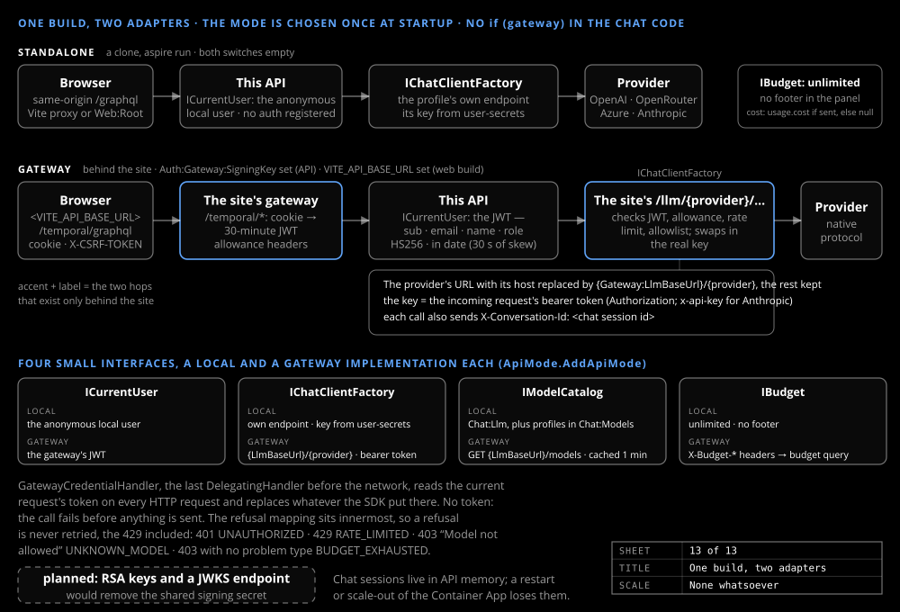

# Models and gateway

_Design & research_

A model is a named profile. The same build runs standalone from a clone or behind the AgentBullpen.AI site's gateway, which holds the keys.

## Which model does what

`Llm:Type` `OpenAI` covers OpenAI, OpenRouter and Azure; `Anthropic` uses the official SDK. Indexing uses Claude Haiku 5.5 (`Indexing:Llm` = `haiku55`); the chat uses `Chat:Llm`, falling back to the `Llm` section, a gpt-4.1-mini deployment.

The indexing choice was settled on the harness: four profiles, three runs each, ranked by facts F1 with entity and held-out F1 within one standard deviation of the baseline, then the cheaper preferred.

| Profile | Facts F1 | Entity F1 | Held-out F1 |
|---|---|---|---|
| gpt-4.1-mini (baseline) | 0.302 | 0.740 | 0.805 |
| gpt-5.6-luna | 0.297 | 0.678 | 0.794 |
| Claude Haiku 5.5 | 0.280 | 0.791 | 0.777 |
| gpt-5.4-mini | 0.280 | 0.739 | 0.748 |

The four sit within one standard deviation on facts F1. Haiku alone passed both bars, with the best entity F1, the most stable output and 30% lower cost. `chat vet` admits a chat model to the site's list: spoiler gates, the answer-length rule, a tool call on every turn.

## Gateway and standalone

One switch per side chooses the mode at startup: `Auth:Gateway:SigningKey` on the API, `VITE_API_BASE_URL` on the web build; leave both empty for a clone. Four interfaces each have a Local and a Gateway implementation; the chat code has no `if (gateway)`. Behind the site the web app shows nothing until the site's `/api/me` confirms a signed-in member; any other answer, or none, sends the visitor to the site's sign-in page. Behind the site the user is the gateway's JWT, model calls go to the site's LLM proxy keyed by the request's token, and the panel shows the member's daily allowance. Standalone, the user is anonymous, the profile's own endpoint and key are used, and a cost is shown only when the provider sends one.

## Telemetry

Every model call goes through one pipeline: sampling, OpenTelemetry, retry, call log, provider. `TemporalGraph.Indexing` spans cover stage, chapter and chunk, `TemporalGraph.Llm` emits GenAI `chat <model>` spans, and `TemporalGraph.Api` records `chat` and `cypher` spans, never the query text.

## Errors

Every error is an RFC 9457 problem with a `type` URI, `title`, `status`, typed extensions and a `traceId`; the type URIs are the site's, so a problem means the same thing at every hop. A problem never carries provider error text, an endpoint or a key. Standalone, `detail` says how to fix a provider failure; behind the site the proxy fails over.
