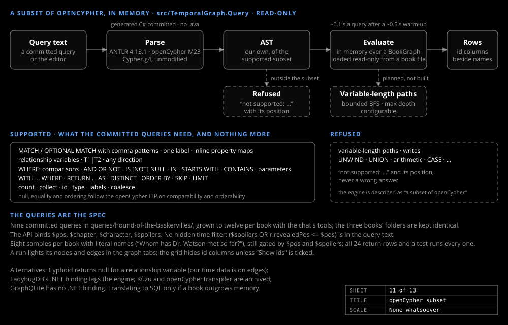

# Query engine

_Design & research_

An own subset of openCypher, evaluated in memory over a book graph loaded read-only from its SQLite file. Anything it cannot evaluate is refused, never answered wrongly.

## What it is

`src/TemporalGraph.Query` holds a parser generated by ANTLR from the unmodified openCypher M23 `Cypher.g4`, an AST of the supported subset, and an evaluator over a `BookGraph`. The subset: `MATCH` / `OPTIONAL MATCH` with comma patterns, one label, inline property maps, relationship variables, `T1|T2`, any direction; `WHERE` with comparisons, `AND OR NOT`, `IS [NOT] NULL`, `IN`, `STARTS WITH`, `CONTAINS`, parameters; `WITH … WHERE`; `RETURN … AS`, `DISTINCT`, `ORDER BY`, `SKIP`, `LIMIT`; `count`, `collect`, `id`, `type`, `labels`, `coalesce`. Variable-length paths, writes, `UNWIND`, `UNION`, arithmetic and `CASE` are refused with "not supported: …" and the line and column, which the API hands back to the editor.

## The committed queries are the spec

What the committed queries in `queries/<book>/` need is supported, and nothing more. The API runs them with `$pos`, `$chapter`, `$character` and `$spoilers` bound, and the chat exposes them as typed tools, so the model never writes Cypher ([Character chat](chat.md)). There is no hidden time filter: the spoiler rule is in the query text ([Two clocks](two-clocks.md)).

Each book also has eight samples in `queries/<book>/samples/`, the tool queries with literal names from the book: "Whom has Dr. Watson met so far?", "What is said about Flint?" (the dead pirate and Silver's parrot share the name). They are still gated by `$pos` and `$spoilers`. The Graph Query tab lists the samples first and the tool queries below, collapsed. A test runs every query against its promoted book. Results keep their id columns, hidden unless "Show ids" is ticked, and a run lights its nodes and edges in the graph tabs ([The graph view](graph-view.md)).

## Why an own engine

No better-established .NET option exists, and all the time data here is on edges, which the one maintained .NET package cannot return. Neo4j's trademark policy forbids "Cypher" in a product name, hence "a subset of openCypher".

| Option | Why not |
|---|---|
| Cyphoid | no relationship variables |
| LadybugDB (Kùzu fork) | native binary per platform, .NET binding lags the engine, schema-first DDL |
| Kùzu | archived upstream |
| GraphQLite | no .NET binding; its own tables would replace the schema |
| Translating to SQL | only if a book outgrows memory |
