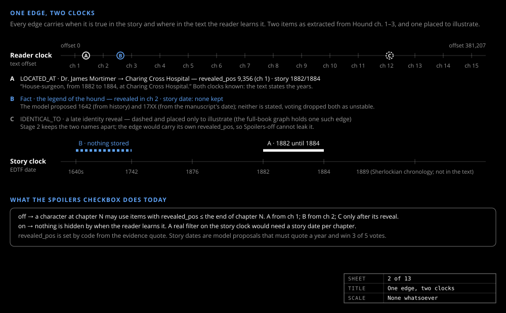

# Two clocks

_Design & research_

Every fact in a novel has two times: when it is true in the story and where the reader is told.

## Where in the text: a position

Every item carries a character offset into the fixed edition text, and one integer drives the slider and the Spoilers-off gate. `revealed_pos` is set by code to the start of the evidence quote, never the model's guess, so it is the one time field trusted completely. `retracted_pos` is set where the text takes the item back.

## When in the story: an uncertain date

The year of *Hound* is debated and most facts are simply "now"; writing `1889-10-01` would be a lie of precision. Story time is stored as EDTF, the Library of Congress format for uncertain dates: `1889-10~` is "about October 1889", `XXXX-05` is "May of some year". `Edtf.cs` derives `_lo` / `_hi` ISO bounds so SQLite can sort and filter. Each item carries a closed-open `[story_from, story_until)` interval.

Unguarded, the model dated the story's present to the year engraved on a walking stick. So a date needs its year in a quote from the text unless marked approximate.

## The anchor date

The text never states the story's present, so Stage 4 picks one plausible anchor date for the first narrated event from the text's own clues, records it in the book's metadata as a labelled assumption, and derives every other date relative to it. A fact inherits its date from its earliest discovering event and a perception from its cause event, by code, so nothing is left undated. A `timeline` table of anchor, chapters and events lets the slider show story time without a query.

## The spoiler rule

`pos` is the slider's text offset; `story(pos)` is the story-time upper bound of the latest-starting timeline row the reader has reached.

- Spoilers off: visible iff `revealed_pos ≤ pos` and `retracted_pos` is null or later than `pos`.
- Spoilers on: visible iff `story_from_lo ≤ story(pos)` and `story_until_lo` is null or later than `story(pos)`. Reveal position is ignored.

The same rule runs in the query engine's `$pos` / `$spoilers` parameters, the chat tools' post-filters and the browser's gate, with a leak test per mode on every build. What most changes in story time is what a character makes of a fact: see [The graph model](graph-model.md).
