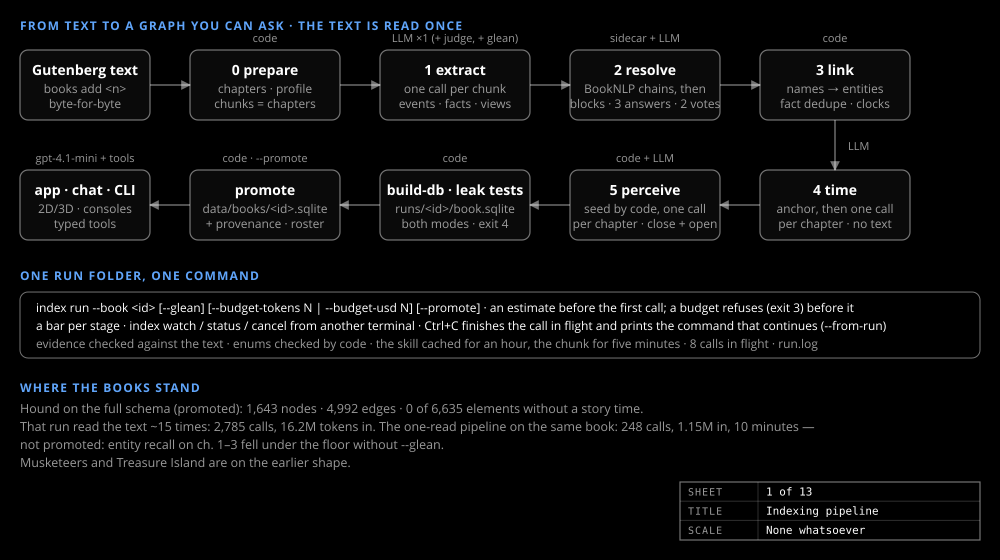

# Getting started

_Guide_

A temporal knowledge graph of a novel, and a character chat gated by what the reader has read. A fresh clone needs no secrets; only indexing and chat call a model.



## Prerequisites

.NET SDK 10.0, the Aspire CLI 13.6 (needed to build the AppHost, not only to run it) and Node.js 22 or later. Not required: Java, Python or a model provider (without one the chat panel says so and everything else works).

## A model for the chat

`./setup.sh` (`.\setup.ps1` on Windows) opens a menu. **Set up chat** asks for a provider (OpenAI, Anthropic, Azure OpenAI or OpenRouter), a model and a key at a hidden prompt and saves one profile under `Llm:Profiles:<name>` with `Chat:Llm` set to it, in the user-secrets store the API and the CLI share. `setup status` shows what is configured, `setup reset` undoes it. More: [Configuration](configuration.md).

## Run it

From the repo folder:

```
aspire run
```

The Aspire dashboard shows `api` (ASP.NET Core, GraphQL at `/graphql`), `web` (Vite + React) and `cli`, an explicit-start resource that runs `index prepare --all` when pressed. Without Aspire: `dotnet build`, `dotnet test`, then `cd web && npm ci && npm test && npm run build`; no test touches the network.

## The app

Three book cards: *The Hound of the Baskervilles*, *The Three Musketeers* and *Treasure Island*. A book view has a chapter slider ("Reader is at"), a **Spoilers** checkbox, a **Character** dropdown and the chat roster: eight characters, each offered once the text has mentioned them. Every screen has a URL (`/book/<id>/query?ch=7&spoilers=1&chat=dr-watson`); the docs are at `/docs`.

**The 2D graph tab** draws characters as discs, locations as diamonds, events as rings and facts as squares, and only what the reader has reached: with Spoilers off, by where the text reveals it; with Spoilers on, by story time. The 3D tab loads on first use. See [The graph view](../design/graph-view.md).

**The chat panel** opens from a roster avatar: the character answers as of the end of chapter N, from typed lookups into the graph only. "What I looked up" lists every tool call, and the answer's rows light up in the graph. See [Character chat](../design/chat.md).

**The Graph Query tab** has ten sample queries, the sixteen queries the chat's tools use, an openCypher editor with **Run** and chips for the live `$character`, `$chapter` and `$spoilers`, and a result table whose rows light their nodes in the graph. See [Query engine](../design/query-engine.md).
