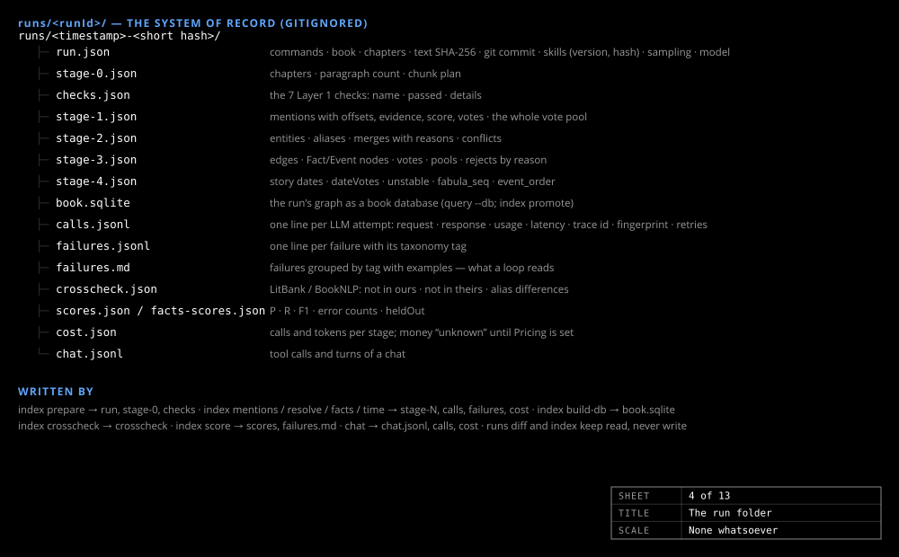
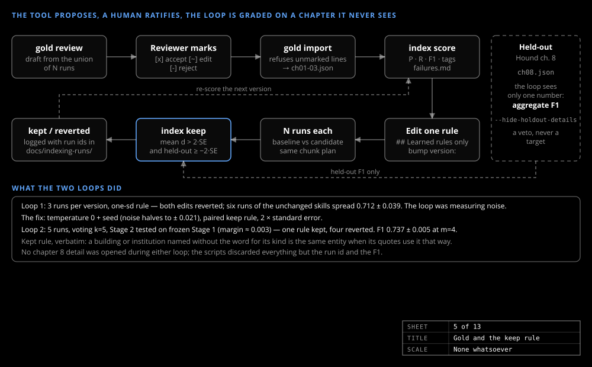

# Indexing a book

_Guide_

A Project Gutenberg book goes from text to a promoted graph with two commands. Every command writes a run folder; nothing reaches the app unless it passes the leak tests and the promotion rule.

## Commands

Run as `dotnet run --project tools/TemporalGraph.Cli -- <command>`; with no arguments the CLI shows a menu.

| Command | What it does |
|---|---|
| `books add <number\|url\|file>` | Downloads the text to `data/books/source/<id>.txt`, writes the manifest entry, detects the chapter headings and runs Stage 0 |
| `index run --book <id>` | Every stage in one run folder, after a pre-flight check and an estimate |
| `index rebuild` | `index run` for every book, promoting each under the rule below without asking |
| `index watch`, `index status --run <id>` | Follow a run from another terminal |
| `index cancel` | Asks a running `index run` to stop |
| `index promote --run <id> --book <id>` | Copies the run's graph into `data/books/<id>.sqlite` with its provenance |
| `index layout --book <id>` \| `--db <path>` | Computes the graph's layout once and stores it on the nodes, in place and with no re-index (`web/scripts/layout.mjs`, Node.js; no model). `build-db` does it for every new graph; without Node.js it reports "layout missing" and the build still succeeds (exit 3 from `index layout` itself) |

Flags on `index run`: `--glean` (a second "what did you miss" call), `--budget-tokens` and `--budget-usd` (the estimate refuses before the first call), `--from-run <id>` (continue a stopped run), `--promote`; `index --stages 2..5 --run <id>` re-runs chosen stages.

Exit codes: 0 ok, 1 bad arguments or a failed call, 2 the model is not configured.

## The run folder

`runs/<runId>/`, gitignored, is the system of record. `run.json` holds the commands, book, text hash, settings, skill versions and state; `run.log` a line per stage, chunk, retry and warning. One JSON file per stage holds what it produced; `calls.jsonl` every model call; `failures.jsonl` every failure with its tag; `cost.json` tokens per stage; `book.sqlite` the run's graph, with `leak-tests.json` beside it.

Stages 1, 4 and 5 ask once per chunk or chapter; only Stage 2 votes. `promote` refuses a file that fails a leak test.

## Gold and the keep rule

The tool proposes; a human ratifies. `gold review` drafts an entity checklist from the union of several runs (`[x]` accept, `[~]` edit, `[-]` reject); `gold import` turns the marked file into JSON and refuses any unmarked line; `index score` reports precision, recall and F1. Only *Hound* has gold: chapters 1–3 for tuning and chapter 8 held out, a code constant no loop can edit.

The keep rule is a paired comparison: baseline and candidate each run N times (default 5) on the same chapters; a change is kept only if its mean gain on the tuning chapters beats twice its standard error and the held-out chapter does not fall by more than that.

The same gold gates `--promote`. A run of part of the book is never promoted; a book with no promoted graph or no gold always is; otherwise the run is scored on the tuning gold (entity F1 and fact F1) and promoted only at or above the promoted graph's recorded scores on both. Without `--promote`, `index run` asks. After promotion the API is rebuilt: the book files are embedded.
