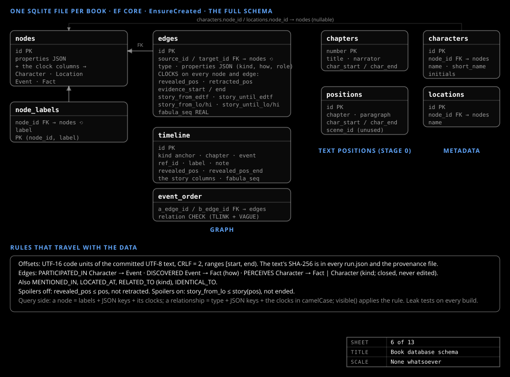

# Database schema

_Guide_

One SQLite file per book, embedded in the API. Every node and edge carries both clocks: where in the text the reader learns it, and when it is true in the story.

## The tables

| Table | What a row is |
|---|---|
| `nodes` | A `Character`, `Location`, `Event` or `Fact`: one JSON `properties` object plus the clock columns and the layout columns (`layout_x`, `layout_y`, `layout_z` for the 3D tab, `layout2_x`, `layout2_y` for the 2D tab; null until a layout is computed). A Fact holds its text, subjects and evidence |
| `edges` | A typed link between two nodes, with the clock columns: `PARTICIPATED_IN` (Character → Event), `DISCOVERED` (Event → Fact, with `how`: `witnessed`, `told`, `overheard`, `inferred`, `read` or `recalled`), `PERCEIVES` (Character → Fact or Character, with a kind such as `believes` or `doubts`), `MENTIONED_IN` (referenced Event → narrated Event), `IDENTICAL_TO`, `LOCATED_AT`, `RELATED_TO` |
| `timeline` | The anchor (an assumed date for the first narrated event), one row per chapter and one per Event |
| `chapters` | Number, title, text range and narrator |
| `positions` | A paragraph: chapter, number and text range |
| `characters`, `locations` | An entity's canonical name linked to its node |

## The two clocks

`revealed_pos` and `retracted_pos` are the reader clock: where the reader learns the element, and where the reader learns it no longer holds. `story_from_edtf` and `story_until_edtf` are the story clock as EDTF, with derived bounds for sorting and `fabula_seq` for what has no date. A perception is never edited: when a later event changes it, the open edge is closed on both clocks and a new one opens.

A query applies the spoiler rule as one function, `visible(x)`, with the caller's `$pos` and `$spoilers`: Spoilers off, revealed by `$pos` and not retracted; Spoilers on, true at the latest story time the reader has reached. The chat tools and the graph view use the same rule. See [Two clocks](../design/two-clocks.md).

## Leak tests and provenance

`index build-db` and `index promote` run five leak tests and refuse a file that fails one: `spoilers-off` and `spoilers-on` (at every chapter end nothing visible was revealed later, and no visible edge has a hidden end), `identity`, `referenced-events` and `clocks`.

`data/books/provenance/<id>.json` records which run a promoted graph came from, with its text hash, skill versions, model and leak-test results, and the layout's `algorithm`, `seed`, `iterations` and `computedAt`.

Two of the three books are on an earlier shape, in which facts hang off entities through `ABOUT` and `STATES` edges and only edges carry clocks; they are read through an upgraded copy.
