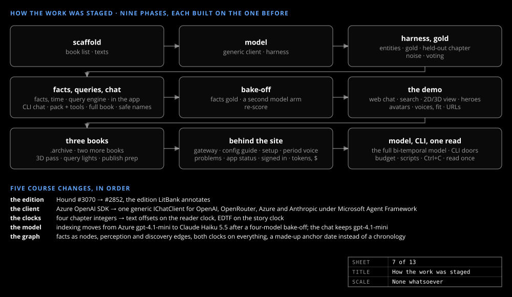

# The question

_The story_

Pick a book, a moment on its timeline and a character, and talk to them. The hard part is the last step: a model that has read the book answers from everything it knows, and a character who does that is a spoiler with a voice.

## The rule

The character's **voice** is authored; the character's **knowledge comes only from a graph of the book as of the selected moment**. The model gets tools that query that graph (what is known about X, whom X has met, where people have been placed) with the moment fixed by the slider, and answers from the tools or says "I don't know". It never writes a query itself: the tools are typed query intents, so there is nothing to inject and nothing to invent.

The **Spoilers** checkbox makes the point. Off, the character knows what the reader has been shown by the selected chapter. On, the character may know everything true in the story by that chapter, even what the reader learns later. Either answer needs two times for every fact in the book, which is why the graph keeps [two clocks](../design/two-clocks.md).

## The claim

Three axes of variation — book × character × moment — run off one fixed engine. A new book costs a text file, a profile and tokens, not code. Three public-domain books test it: *The Hound of the Baskervilles*, *The Three Musketeers* and *Treasure Island*, each indexed end to end and talkable in the browser. The claim holds with one footnote: *Treasure Island* heads its chapters with bare Roman numerals, so Stage 0 learned a second heading style, a small code change made once.

## The shape of the work

The sheet above shows the order: a scaffold that builds, tests and starts from a fresh clone; model access; an evaluation harness and a gold set, built before the extractor they measure; the facts, the queries, the app and the chat; a bake-off between candidate models; a second graph and the demo; the three books; the site behind the demo; the model done properly; a CLI someone else could run and audit answer by answer; and a pipeline that reads the text once.
