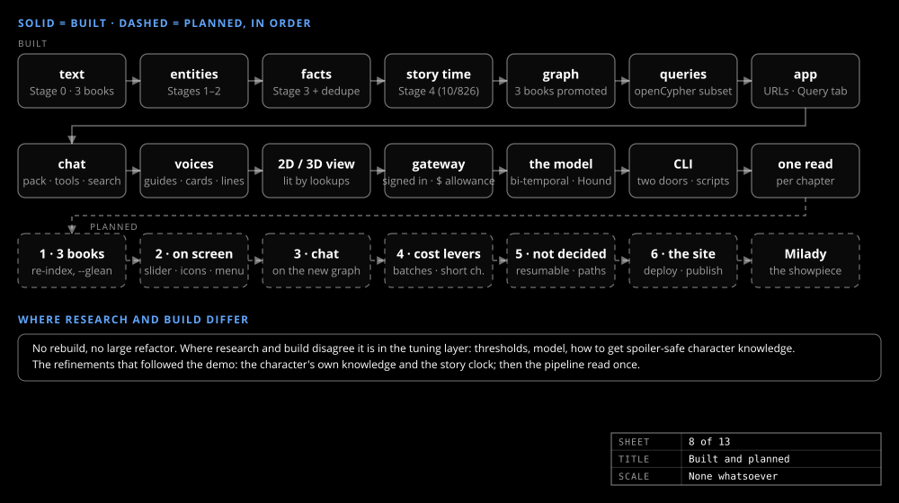

# What's next

_The story_

The demo runs for three books, in the browser and behind the site. The per-character knowledge model is built for *Hound*, and the pipeline that makes it reads the text once. The planned work starts there.

## In order

- **The three books on the new model.** *Hound* first, then *Musketeers* and *Treasure Island*, which stay on the earlier shape until theirs land: a re-index with `--glean` (the one lever that brought entity recall back to the floor) under a token budget, promoting only when the leak tests pass. Each run reports `DISCOVERED` by route, `PERCEIVES` by kind, story time with zero nulls and the gold scores against the floor.
- **The graph on screen, and the chat on the new graph.** The timeline slider gains a story-time axis, edges their perception icons, facts the Fact shape. The typed tools are rewritten (`facts_discovered_by`, `perceptions_of`, `events_of`, `referenced_events`); the perception history then allows a character who answers from what they believed *then*. Also: which model the characters use (`Chat:Llm`), search synonyms, a smaller cap for `search_facts`, session persistence and streaming.
- **Cost levers not yet pulled.** Message Batches (half price; needs a direct-SDK path beside MEAI); pairing very short chapters into one chunk; a configured price so `cost.json` and the pre-flight say dollars instead of "not known".
- **The site's side.** The Container App for the API, the Static Web App, its CORS origin and the gateway's cluster address; the Admin item in the user menu; publishing the repo.

## One thing meant to be discovered

One showpiece from the design notes: Milady de Winter, with the slider past her death — an omniscient ghost who knows the whole graph, knows she is a literary character and, asked about the afterlife, answers that hers is being re-read. Hand-crafted, used once, never generalized into a rule. *Musketeers* has its full graph and Milady on its roster, so it has somewhere to live.
